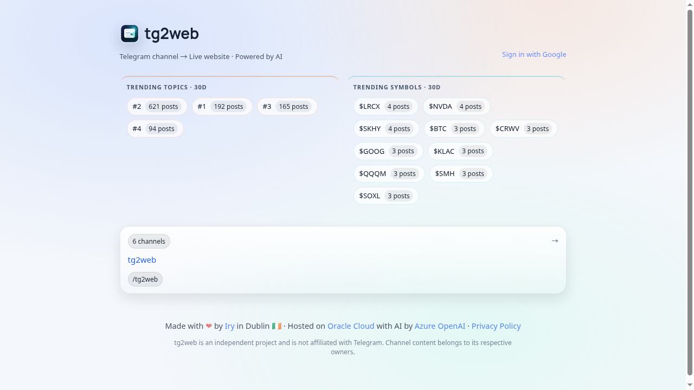
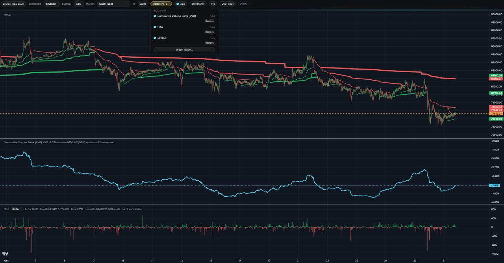
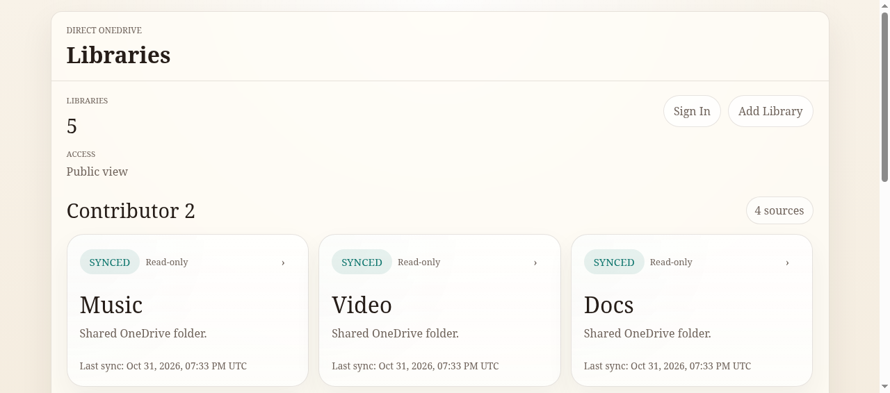

### Hi, I'm Iry 👋

I'm based in Dublin and work at Microsoft. Outside work, I build practical tools that turn streams of information into clear, useful web interfaces — mostly with Rust, real-time data, and the web.

*Think recursively.*

---

### Projects

#### [tg2web](https://tg2web.live) — Telegram channels as live websites

Turns a Telegram channel into a website people can read and share — no Telegram app required.

- Live post updates while readers are on a channel page
- Shareable, search-engine-friendly pages for posts
- Weekly AI digests, plus comments that extend discussion beyond Telegram

**Live:** [tg2web.live](https://tg2web.live)

#### [CVD](https://cvdd.kljsandjb.me) — crypto order-flow workspace

Cumulative volume delta and order-flow views from centralized exchanges, meant as confirmation alongside key support/resistance levels — not as a standalone signal.

- Rust backend with PostgreSQL market history
- CVD and flow indicators run in the browser as imported WebAssembly plugins

The price-level overlay in this screenshot is a custom imported indicator, not bundled with the public plugins.

**Live:** [cvdd.kljsandjb.me](https://cvdd.kljsandjb.me) · **Source:** [cvd-core](https://github.com/k0Iry/cvd-core) · [cvd-indicators](https://github.com/k0Iry/cvd-indicators)

#### [Direct OneDrive](https://kljsandjb.me) — shared OneDrive libraries

Connect one or more OneDrive accounts, choose folders to share, and browse them through a clean library dashboard.

- Shared folders shown as library cards, grouped by account
- In-browser previews for text, code, images, PDFs, audio, and video
- Sharing can be disconnected at any time

**Live:** [kljsandjb.me](https://kljsandjb.me)
